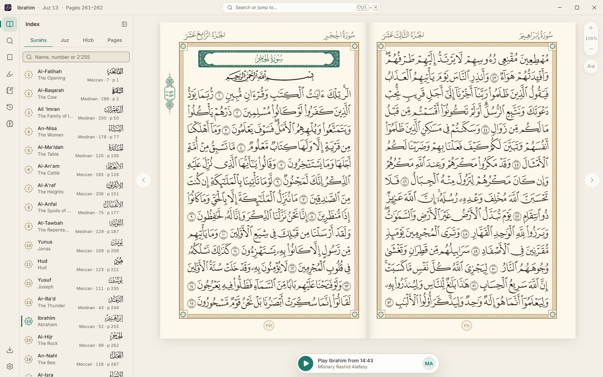

<p align="center"></p>

# Quran for Desktop

<p dir="rtl" lang="ar"><b>قرآن لسطح المكتب</b></p>

An offline-first Quran reader for Windows, macOS and Linux: the Madani Mushaf page by page, recitation with
word-by-word highlighting, translations, tafsir, search and memorisation.

> **Status:** in development, not yet released. The app carries the identity of the [Quran.com](https://quran.com)
> project, pending the approval of its maintainers.



## Build

You need Node.js 22.12+, pnpm 10.24, Rust 1.99 and the [Tauri 2 prerequisites](https://tauri.app/start/prerequisites/).

```sh
pnpm i --frozen-lockfile
pnpm assets                            # the bundled Hafs font
pnpm core:qdc                          # a development core.db (keep it on your machine)
pnpm tauri build --debug --no-bundle   # the app (or `pnpm app:dev` for live reload)
```

On Windows, use a short `CARGO_TARGET_DIR` such as `C:\qdt\t`. Tests, data and everything else are in
[`docs/DEVELOPING.md`](docs/DEVELOPING.md).

## Data

The Quran text, fonts, translations, tafsir and recitations belong to their publishers and are used under their own
terms; the app credits each one under **About**. A development `core.db` is never committed or shared.

## Licence

[GPL-3.0-or-later](LICENSE). Third-party fonts, data and audio keep their own licences.
